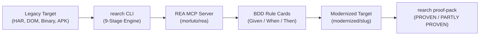

# `rearch`

[](https://github.com/mehdibadjian/rearch/actions/workflows/ci.yaml)
[](https://github.com/mehdibadjian/rearch/releases)
[](https://www.rust-lang.org/)
[](LICENSE)

> **Autonomous reverse-engineering and modernization harness built in Rust.**  
> Orchestrates **REA (`morluto/rea`)** inside a bounded **`/loop` + `/goal`** state machine governed by the 9-stage **`code-modernization`** workflow.

---

## 🧭 Overview

`rearch` is a deterministic harness designed for modernizing complex legacy software systems (web services, client SPAs, `.har` captures, native ELF/PE/Mach-O binaries, archives, and APKs) without human drift or LLM hallucination.

It couples **autonomous specialist AI agents** using format-aware Model Context Protocol (MCP) tools with a **strict Rust runtime** that enforces:
- **Cryptographic Legacy Immutability:** SHA-256 digest validation ensures legacy code is never accidentally modified.
- **6 Unbypassable Human Decision Gates:** Human operators control scope, rule disputes, architecture sign-offs, divergences, proof acceptance, and security hardening.
- **Epistemic Discipline:** Categorizes all reverse-engineered findings into 4 tiers (`OBSERVATION`, `DERIVATION`, `INFERENCE`, `UNKNOWN`) with byte/line provenance.
- **Bounded Loops & 2-Turn Stall Guards:** Prevents runaway agent loops and infinite token expenditures.
- **Deterministic Clean-Run Proof Pack:** Purges dirty caches and parses test counts directly from machine test runners (`cargo test`, JUnit XML, Vitest JSON)—never trusting conversational summaries.



---

## 📚 Repository Wiki & Documentation

Comprehensive documentation is available in the [**Repository Wiki**](wiki/Home.md):

- 🏠 **[Wiki Home](wiki/Home.md)** — Getting started, conceptual overview, and workflow.
- 🏗️ **[Architecture & Design](wiki/Architecture-and-Design.md)** — Workspace crates, data contracts, and report generation.
- 🔄 **[The 9-Stage Pipeline](wiki/The-9-Stage-Pipeline.md)** — Detailed walkthrough of Stages 0 through 8.
- 🚦 **[Human Decision Gates](wiki/Human-Decision-Gates.md)** — Gates 1–6 criteria, schemas, and legacy locking.
- 🔁 **[Autonomous Loop Engine](wiki/Autonomous-Loop-Engine.md)** — Two-window loop (`discover` & `build`) and stall detection.
- 🔍 **[REA & Reverse Engineering](wiki/REA-Engine-and-Reverse-Engineering.md)** — MCP bridge, Chrome CDP manager, and REA Laws.
- 🏷️ **[Epistemic Tiers & BDD Rules](wiki/Epistemic-Tiers-and-BDD-Rule-Cards.md)** — Given/When/Then cards and executable truth.
- 🧼 **[Deterministic Proof Pack](wiki/Deterministic-Proof-Pack.md)** — Clean-run verifier, XML/JSON parsers, and verdicts.
- 👥 **[Specialist Agents](wiki/Specialist-Agents.md)** — Critic, extractor, verifier, and simplifier roles.
- 💻 **[Multi-Host Setup](wiki/Multi-Host-Setup.md)** — Antigravity, VS Code Copilot, and Claude Code guides.
- 📖 **[CLI Reference](wiki/CLI-Reference.md)** — Subcommands, arguments, and flags.

Additional specifications:
- [Business Requirements Document (BRD)](docs/BRD.md)
- [Implementation Plan](docs/IMPLEMENTATION_PLAN.md)

---

## 📦 Workspace Architecture

The harness is organized into 4 modular Rust crates:

| Crate | Path | Description |
| :--- | :--- | :--- |
| **`rearch-core`** | [`crates/rearch-core`](crates/rearch-core) | Core data models (`RuleCard`, `BddSpec`, `EvidenceRow`, `ProofVerdict`), Gates 1–6 validation, SHA-256 legacy verification, and prompt-injection defense. |
| **`rearch-rea`** | [`crates/rearch-rea`](crates/rearch-rea) | Stdio JSON-RPC client bridging `rea-agents` MCP server, REA session deduplication, Smallest Inventory First enforcement, and Chrome CDP manager. |
| **`rearch-proof`** | [`crates/rearch-proof`](crates/rearch-proof) | Clean-build test execution, machine test parser (`cargo`, JUnit XML, Vitest JSON), and Askama HTML dashboard generator (`analysis/<slug>/REPORT.html`). |
| **`rearch-cli`** | [`crates/rearch-cli`](crates/rearch-cli) | Primary executable (`rearch`), multi-host bootstrapper, and 2-window bounded loop state machine. |

---

## ⚡ Quick Start

### 1. Prerequisites
- [Rust](https://rustup.rs/) (1.78+ / 2021 Edition)
- [Node.js](https://nodejs.org/) (v18+) & `npx`
- Chrome / Chromium (optional, for frontend CDP inspection)

### 2. Multi-Host Environment Bootstrap
Run the bootstrapper to check or configure your agent environment across Antigravity, VS Code Copilot, and Claude Code:
```bash
# Check environment readiness
cargo run --bin rearch -- bootstrap --mode doctor

# Preview configuration changes
cargo run --bin rearch -- bootstrap --mode dry-run

# Apply configuration
cargo run --bin rearch -- bootstrap --mode apply
```

### 3. Running a Modernization Workflow
```bash
# Stage 0: Initialize modernization intent
cargo run --bin rearch -- intent my-service

# Stage 1: Preflight check & Gate 1 locking
cargo run --bin rearch -- preflight my-service

# Loop Window A: Discovery & BDD Rule Extraction
cargo run --bin rearch -- loop-step my-service discover --max-iterations 25

# Stage 4b: Review disputed rules (Gate 2)
cargo run --bin rearch -- review my-service

# Stage 5: Sign the architecture steering brief (Gate 3)
cargo run --bin rearch -- sign my-service

# Loop Window B: Code Reconstruction & Verification
cargo run --bin rearch -- loop-step my-service build --max-iterations 50

# Stage 7: Clean-run proof pack verification (Gates 4 & 5)
cargo run --bin rearch -- proof-pack my-service

# Stage 8: Generate security hardening patch (Gate 6)
cargo run --bin rearch -- harden my-service
```

---

## 🤖 Multi-Host Agent Support

`rearch` is natively supported across leading AI development environments:

- **Google Antigravity:** Automated workflow and specialist subagent definitions in [`.antigravity/config.json`](.antigravity/config.json).
- **VS Code Copilot:** Native MCP integration in [`.vscode/mcp.json`](.vscode/mcp.json), task runners in [`.vscode/tasks.json`](.vscode/tasks.json), and chat prompt in [`.github/prompts/rearch-loop.prompt.md`](.github/prompts/rearch-loop.prompt.md).
- **Claude Code:** Registered stdio MCP configuration in [`.claude/settings.json`](.claude/settings.json) and custom slash command in [`.claude/commands/rearch-loop.md`](.claude/commands/rearch-loop.md).

---

## 🧪 Testing

Run the full deterministic test suite across all 4 crates:
```bash
cargo test --workspace
cargo clippy --workspace --all-targets -- -D warnings
cargo fmt -- --check
```

---

## 📄 License

Dual-licensed under either of:
- Apache License, Version 2.0 ([LICENSE-APACHE](LICENSE-APACHE) or http://www.apache.org/licenses/LICENSE-2.0)
- MIT license ([LICENSE-MIT](LICENSE-MIT) or http://opensource.org/licenses/MIT)

at your option.
