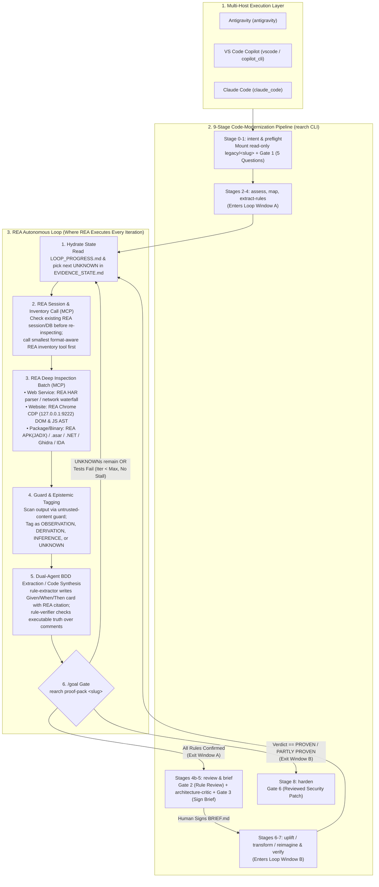
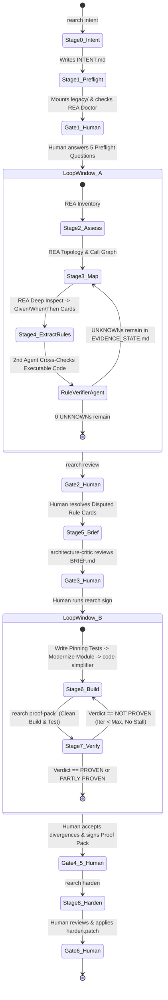

# Business Requirements Document (BRD)

**Document Version:** 1.0

**System Name:** `rearch`

**Core Dependencies:** `morluto/rea` (`rea-agents` MCP Server & Skill Suite), `anthropics/claude-plugins-official/plugins/code-modernization`

**Implementation Language:** Rust (Cargo Workspace, Edition 2021)

**Target Hosts:** Antigravity (`antigravity`), VS Code Copilot (`vscode` / `copilot_cli`), Claude Code (`claude_code`)

---

## 1. Purpose & System Scope

`rearch` is an autonomous reverse-engineering and modernization harness built in Rust. It orchestrates **REA (`morluto/rea`)** inside an iterative **`/loop` + `/goal`** execution engine governed by the 9-stage **`code-modernization`** workflow:

1. **Target Ingestion:** Accepts any web service (live URL or `.har` capture), website (live DOM/JS bundles via Chrome DevTools Protocol), or packaged file (`.asar`, `.apk`, `.wasm`, `.NET` assembly, archive, or native ELF/PE/Mach-O binary).
2. **Evidence-Driven Inspection (`REA` inside `/loop`):** Iteratively invokes REA's Model Context Protocol (MCP) tools to inspect artifacts, extract behavioral rules into `Given/When/Then` specifications with exact `artifact:line/offset` provenance, and map system topology.
3. **Verifiable Reconstruction (`/goal`):** Reconstructs clean-room specifications (`openapi.yaml`, `schema.graphql`, architecture docs) or target source code (`modernized/<slug>`) and halts only when the deterministic Rust proof engine (`rearch proof-pack <slug>`) returns `PROVEN` or `PARTLY PROVEN`.

---

## 2. System & Loop Architecture (Mermaid)

### 2.1 Exact Position of `REA` Inside the Autonomous `/loop` and `/goal`



---

## 3. Where `REA` Operates in Each Stage & Loop Turn

`REA` is not a passive plugin; it is the **sole inspection authority** inside every iteration of the autonomous loop. The Rust crate `crates/rearch-rea` connects to the `rea-agents` MCP server over stdio JSON-RPC and enforces four operational laws from REA's `SKILL.md`:

### 3.1 REA Tool Routing by Target Type

| Target Type | Pre-Loop Setup (`rearch preflight`) | Loop Step 2: Smallest Inventory First (REA MCP) | Loop Step 3: Hypothesis-Driven Deep Inspection (REA MCP) | Loop Step 6: `/goal` Parity Input (`rearch proof-pack`) |
| --- | --- | --- | --- | --- |
| **Web Service** (`.har` or URL) | Mount `.har` in `legacy/<slug>` or attach Chrome CDP (`127.0.0.1:9222`). | `rea` HAR/network summary tool to list all hosts, routes, status codes, and MIME types. | `rea` request/response body inspector to extract auth headers, pagination cursors, and payload schemas per route. | Recorded request/response pairs replayed against reconstructed OpenAPI spec or service implementation. |
| **Website / Frontend** (Live URL / Bundle) | Launch isolated Chrome (`--remote-debugging-port=9222 --remote-debugging-address=127.0.0.1`). | `rea` CDP script/DOM inventory to list loaded bundles, source maps, custom elements, and global state stores. | `rea` live script evaluator, breakpoint/trace inspector, and computed CSS token extractor for specific UI workflows. | Headless DOM/state assertions comparing live CDP snapshot against `modernized/<slug>`. |
| **Packaged File / Binary** (`.apk`, `.asar`, `.wasm`, `.dll`, ELF/PE/Mach-O) | Compute SHA-256 digest; symlink into `legacy/<slug>`; verify read-only permissions. | `rea` format-aware inventory (archive manifest, Electron boundary map, JADX package tree, .NET metadata table, or binary symbol exports). | `rea` decompiler/disassembler tools (JADX class bodies, CIL disassembly, or ephemeral read-only Ghidra/Hopper/IDA function pseudocode). | Extracted input/output test vectors executed against reconstructed modules in `modernized/<slug>`. |

### 3.2 Mandatory REA Loop Discipline (Enforced per Iteration)

1. **Reuse Before Re-Inspecting:** On iteration start, `rearch-rea` checks active REA sessions, saved analysis databases, and `analysis/<slug>/EVIDENCE_STATE.md`. It never opens a duplicate Ghidra/JADX/CDP session if one is already indexed for the target SHA-256 digest.
2. **Smallest Useful Inventory First:** The loop controller blocks deep function decompilation or full-bundle AST dumps until the target's top-level inventory (`analysis/<slug>/map.json`) is populated.
3. **Four Epistemic Tiers:** Every piece of data returned by an REA tool is parsed by `crates/rearch-core` and written to `analysis/<slug>/EVIDENCE_STATE.md` as one of:
* `OBSERVATION`: Raw, unaltered REA tool output with exact provenance (`file:line`, binary address, HAR entry ID, or DOM selector).
* `DERIVATION`: Deterministic transformation of observations (e.g., JSON Schema or OpenAPI type synthesized from observed payloads).
* `INFERENCE`: Architectural hypothesis linking multiple observations.
* `UNKNOWN`: Open question queued for the next `/loop` iteration.
4. **Executable Truth Over Comments:** If a legacy source comment or string literal claims behavior that contradicts REA's observed bytecode, AST, or network trace, the loop flags `comment_discrepancy_flagged: true` on the rule card and trusts only the executable evidence.

---

## 4. End-to-End 9-Stage Pipeline & Human Decision Gates

The system combines autonomous `/loop` execution with **6 mandatory human decision gates** that cannot be bypassed by an LLM:



### The 6 Human Decision Gates (`crates/rearch-core/src/gates.rs`)

* **Gate 1 (5 Preflight Questions):** Human specifies: (1) whole system vs. slice, (2) whether legacy runs locally, (3) custom build tooling, (4) prior attempts, and (5) off-limits components.
* **Gate 2 (Disputed Business Rules):** Human confirms or edits any `Given/When/Then` rule card where the primary `rule-extractor` and secondary `rule-verifier` disagreed.
* **Gate 3 (Steering Brief Sign-Off):** Human reviews `analysis/<slug>/BRIEF.md` (including findings from the read-only `architecture-critic` agent) and signs off before any file in `modernized/<slug>` can be written.
* **Gate 4 (Behavioral Divergences):** Any difference between `legacy/<slug>` and `modernized/<slug>` outputs must be explicitly accepted by a human in `accepted_divergences.json` or fixed by the loop.
* **Gate 5 (Proof Pack Sign-Off):** Human signs off on the final `PROVEN` or `PARTLY PROVEN` verdict in `analysis/<slug>/REPORT.html`.
* **Gate 6 (Hardening Patch):** Human reviews and applies `analysis/<slug>/harden.patch`.

---

## 5. Multi-Host Workspace & Rust Crate Specification

### 5.1 Repository Layout

```text
rearch/
├── Cargo.toml                                 # Workspace root
├── INTENT.md                                  # Stage 0 output
├── crates/
│   ├── rearch-cli/                            # Binary: `rearch`
│   │   ├── Cargo.toml
│   │   └── src/
│   │       ├── main.rs                        # Subcommands for all 9 stages + loop + bootstrap
│   │       ├── bootstrap.rs                   # Runs `npx rea-agents doctor/setup` for all 4 client IDs
│   │       └── loop_runner.rs                 # /loop + /goal state machine & stall guard
│   ├── rearch-core/                           # Models, 6 Human Gates & Untrusted Content Guard
│   │   ├── Cargo.toml
│   │   └── src/
│   │       ├── lib.rs
│   │       ├── models.rs                      # RuleCard, EvidenceRow, EpistemicTier, ProofVerdict
│   │       ├── gates.rs                       # Gate 1-6 state validators & SHA-256 legacy lock
│   │       └── guard.rs                       # Prompt-injection scanner for untrusted legacy inputs
│   ├── rearch-rea/                            # Rust MCP Client & Chrome CDP Manager
│   │   ├── Cargo.toml
│   │   └── src/
│   │       ├── lib.rs
│   │       ├── mcp_client.rs                  # Stdio JSON-RPC client calling `rea-agents` tools
│   │       └── cdp.rs                         # Isolated Chrome `--remote-debugging-port=9222` manager
│   └── rearch-proof/                          # Clean-Run Proof Engine & HTML Report Generator
│       ├── Cargo.toml
│       ├── templates/
│       │   └── report.html                    # Askama template for `analysis/<slug>/REPORT.html`
│       └── src/
│           ├── lib.rs
│           ├── verifier.rs                    # Clean-build runner & JUnit/JSON test count parser
│           └── report.rs                      # Compiles topology, BDD rules & verdict into REPORT.html
├── legacy/<slug>                              # Immutable symlink/mount to target artifact
├── analysis/<slug>/
│   ├── REPORT.html                            # Refreshed after every command
│   ├── BRIEF.md                               # Phased plan + architecture-critic findings
│   ├── EVIDENCE_STATE.md                      # REA Provenance table
│   ├── LOOP_PROGRESS.md                       # Append-only per-iteration log
│   ├── preflight.json                         # Gate 1 answers & legacy SHA-256 digest
│   ├── map.json                               # Dependency & route topology
│   ├── rules/*.json                           # BDD Given/When/Then cards with REA citations
│   └── proof/verdict.json                     # Machine-verified proof pack output
├── modernized/<slug>/                         # Reconstructed specs (OpenAPI/GraphQL) & target code
├── .agents/
│   ├── skills/reverse-engineer-anything/SKILL.md
│   └── agents/
│       ├── architecture-critic.md
│       ├── rule-extractor.md
│       ├── rule-verifier.md
│       └── code-simplifier.md
├── .claude/
│   ├── settings.json                          # Registers `rea` MCP + disables nonessential telemetry
│   └── commands/rearch-loop.md                # Claude Code `/rearch-loop` command
├── .vscode/
│   ├── mcp.json                               # VS Code Copilot `rea` MCP registration
│   └── tasks.json                             # Cargo tasks for `rearch` subcommands
├── .github/
│   ├── copilot-instructions.md                # Shared REA + Modernization rules for VS Code Copilot
│   └── prompts/rearch-loop.prompt.md          # VS Code `/rearch-loop` prompt
├── .antigravity/
│   └── config.json                            # Antigravity agent & workflow configuration
├── AGENTS.md
└── CLAUDE.md

```

---

## 6. Core Rust Specifications (For Antigravity to Implement)

### 6.1 Workspace `Cargo.toml`

```toml
[workspace]
resolver = "2"
members = [
    "crates/rearch-cli",
    "crates/rearch-core",
    "crates/rearch-rea",
    "crates/rearch-proof",
]

[workspace.package]
version = "1.0.0"
edition = "2021"

[workspace.dependencies]
anyhow = "1.0"
askama = "0.12"
chrono = { version = "0.4", features = ["serde"] }
clap = { version = "4.5", features = ["derive"] }
goblin = "0.9"
quick-xml = { version = "0.36", features = ["serialize"] }
regex = "1.11"
serde = { version = "1.0", features = ["derive"] }
serde_json = "1.0"
sha2 = "0.10"
thiserror = "2.0"
tokio = { version = "1.40", features = ["full"] }
walkdir = "2.5"

```

### 6.2 REA MCP Bridge & Session Reuse (`crates/rearch-rea/src/mcp_client.rs`)

Spawns `npx -y rea-agents@latest` over stdio JSON-RPC, enforces session reuse by checking target SHA-256 digests before opening new analysis sessions, and scans all returned observations through `rearch_core::guard::scan_untrusted_output`:

```rust
use anyhow::{Context, Result};
use rearch_core::guard::scan_untrusted_output;
use serde_json::{json, Value};
use std::process::Stdio;
use tokio::io::{AsyncBufReadExt, AsyncWriteExt, BufReader};
use tokio::process::{Child, ChildStdin, ChildStdout, Command};

pub struct ReaMcpClient {
    _child: Child,
    stdin: ChildStdin,
    stdout: BufReader<ChildStdout>,
    next_id: u64,
}

impl ReaMcpClient {
    pub async fn spawn() -> Result<Self> {
        let mut child = Command::new("npx")
            .args(["-y", "rea-agents@latest", "mcp"])
            .stdin(Stdio::piped())
            .stdout(Stdio::piped())
            .stderr(Stdio::inherit())
            .spawn()
            .context("Failed to spawn rea-agents MCP server")?;

        let stdin = child.stdin.take().context("Missing stdin")?;
        let stdout = BufReader::new(child.stdout.take().context("Missing stdout")?);

        Ok(Self {
            _child: child,
            stdin,
            stdout,
            next_id: 1,
        })
    }

    /// Calls an REA MCP tool and automatically runs the untrusted-content prompt-injection guard
    pub async fn call_tool(&mut self, slug: &str, tool_name: &str, arguments: Value) -> Result<Value> {
        let req_id = self.next_id;
        self.next_id += 1;

        let payload = json!({
            "jsonrpc": "2.0",
            "id": req_id,
            "method": "tools/call",
            "params": {
                "name": tool_name,
                "arguments": arguments
            }
        });

        let mut line = serde_json::to_string(&payload)?;
        line.push('\n');
        self.stdin.write_all(line.as_bytes()).await?;
        self.stdin.flush().await?;

        let mut resp_line = String::new();
        self.stdout.read_line(&mut resp_line).await?;
        let resp: Value = serde_json::from_str(&resp_line)?;

        let raw_text = resp.to_string();
        scan_untrusted_output(slug, tool_name, &raw_text)?;

        Ok(resp["result"].clone())
    }
}

```

### 6.3 Autonomous Loop Runner (`crates/rearch-cli/src/loop_runner.rs`)

Executes the bounded `/loop` for either Discovery (Window A) or Reconstruction (Window B), enforcing the 2-turn stall detector and deterministic `/goal` exit check:

```rust
use anyhow::{bail, Result};
use rearch_core::gates::{verify_gate_1_locked, verify_gate_3_signed, verify_legacy_unmodified};
use rearch_core::models::ProofVerdict;
use rearch_proof::{report::render_html_report, verifier::run_proof_pack};
use std::{fs, path::Path};

pub fn execute_loop_step(slug: &str, window: &str, max_iterations: u32) -> Result<()> {
    let analysis_dir = Path::new("analysis").join(slug);
    verify_legacy_unmodified(slug)?;
    verify_gate_1_locked(slug)?;

    let progress_path = analysis_dir.join("LOOP_PROGRESS.md");
    let progress = fs::read_to_string(&progress_path).unwrap_or_default();
    let lines: Vec<&str> = progress.lines().filter(|l| !l.trim().is_empty()).collect();

    if lines.len() as u32 >= max_iterations {
        bail!("LOOP HALT: Max iteration cap ({max_iterations}) reached for {slug}.");
    }

    // Stall detector: halt if the last 2 iterations produced identical progress signatures
    if lines.len() >= 2 && lines[lines.len() - 1] == lines[lines.len() - 2] {
        bail!("LOOP HALT: Stall detected (2 consecutive identical outcomes). Pivot required.");
    }

    match window {
        "discover" => {
            let evidence = fs::read_to_string(analysis_dir.join("EVIDENCE_STATE.md")).unwrap_or_default();
            let open_unknowns = evidence.lines().filter(|l| l.contains("`UNKNOWN`")).count();
            render_html_report(slug)?;
            if open_unknowns == 0 && evidence.contains("| **Q-") {
                println!("GOAL MET [Window A]: 0 UNKNOWNs remain in EVIDENCE_STATE.md.");
                return Ok(());
            }
            bail!("CONTINUE_LOOP: {open_unknowns} UNKNOWN items remain in EVIDENCE_STATE.md.");
        }
        "build" => {
            verify_gate_3_signed(slug)?;
            let report = run_proof_pack(slug)?;
            render_html_report(slug)?;
            match report.verdict {
                ProofVerdict::Proven | ProofVerdict::PartlyProven => {
                    println!("GOAL MET [Window B]: Verdict is {:?} ({})", report.verdict, report.details);
                    Ok(())
                }
                ProofVerdict::NotProven => {
                    bail!("CONTINUE_LOOP: Verdict is NOT PROVEN ({})", report.details);
                }
            }
        }
        _ => bail!("Unknown loop window: {window}. Expected 'discover' or 'build'."),
    }
}

```

### 6.4 Multi-Host Bootstrapper (`crates/rearch-cli/src/bootstrap.rs`)

Provisions `rea-agents` across all four client targets (`antigravity`, `vscode`, `copilot_cli`, `claude_code`):

```rust
use anyhow::Result;
use std::process::Command;

const CLIENTS: [&str; 4] = ["antigravity", "vscode", "copilot_cli", "claude_code"];

pub fn run_bootstrap(mode: &str) -> Result<()> {
    for client in CLIENTS {
        let args: Vec<&str> = match mode {
            "doctor" => vec!["-y", "rea-agents@latest", "doctor", "--client", client, "--json"],
            "dry-run" => vec!["-y", "rea-agents@latest", "setup", "--client", client, "--dry-run", "--json"],
            "apply" => vec!["-y", "rea-agents@latest", "setup", "--client", client, "--yes", "--json"],
            _ => anyhow::bail!("Unsupported mode: {mode}. Expected doctor, dry-run, or apply."),
        };
        let status = Command::new("npx").args(&args).status()?;
        if !status.success() {
            eprintln!("REA {mode} returned non-zero for client: {client}");
        }
    }
    Ok(())
}

```

### 6.5 Deterministic Proof Verifier (`crates/rearch-proof/src/verifier.rs`)

Enforces the clean-run rules from `code-modernization`:

1. Deletes cached build/test outputs before running tests.
2. Parses test counts strictly from machine-readable test runner files (never LLM summaries).
3. Fails any run that executes `0` tests (`total == 0`).
4. Verifies `legacy/<slug>` SHA-256 digest is untouched.
5. Outputs `PROVEN`, `PARTLY PROVEN`, or `NOT PROVEN` to `analysis/<slug>/proof/verdict.json`.

---

## 7. Host Adapter Configurations

### 7.1 Claude Code (`.claude/commands/rearch-loop.md` & `.claude/settings.json`)

* `.claude/settings.json` sets `"env": { "CODE_MODERNIZATION_TELEMETRY": "0", "CLAUDE_CODE_DISABLE_NONESSENTIAL_TRAFFIC": "1" }` and binds the `rea` MCP server.
* `.claude/commands/rearch-loop.md` wires `/rearch-loop <slug> <discover|build>` to invoke REA MCP tools, update `analysis/<slug>/EVIDENCE_STATE.md` and `analysis/<slug>/rules/*.json`, log to `LOOP_PROGRESS.md`, and gate exit on `cargo run --bin rearch -- loop-step <slug> <discover|build>`.

### 7.2 VS Code Copilot (`.vscode/mcp.json` & `.github/prompts/rearch-loop.prompt.md`)

* `.vscode/mcp.json` registers `rea-agents` for GitHub Copilot Agent Mode.
* `.github/prompts/rearch-loop.prompt.md` exposes `/rearch-loop` in VS Code Chat using the identical `rearch` binary gates and `.agents/agents/*` specialist definitions.

### 7.3 Antigravity (`.antigravity/config.json`)

* Maps the 4 specialist subagents (`architecture-critic`, `rule-extractor`, `rule-verifier`, `code-simplifier`) and binds the `rearch` binary as the deterministic step verifier.

---

## 8. Acceptance Criteria for Antigravity Build

| Gate ID | Verification Command | Pass Condition |
| --- | --- | --- |
| **AC-01** | `cargo build --workspace --release` | Compiles all 4 crates (`rearch-cli`, `rearch-core`, `rearch-rea`, `rearch-proof`) with zero errors. |
| **AC-02** | `cargo run --bin rearch -- bootstrap --mode doctor` | Invokes `rea-agents doctor` for `antigravity`, `vscode`, `copilot_cli`, and `claude_code` and prints JSON diagnostics. |
| **AC-03** | `cargo test --workspace` | Unit and integration tests confirm: (1) all 6 Human Decision Gates block unauthorized transitions, (2) `guard.rs` catches prompt injection inside mock legacy artifacts, (3) `verifier.rs` marks `0`-test runs as `NOT PROVEN`, and (4) mutating `legacy/<slug>` fails verification. |
| **AC-04** | `cargo run --bin rearch -- proof-pack sample-slug` | Wipes cached test outputs, executes the test runner, writes `analysis/sample-slug/proof/verdict.json`, and renders `analysis/sample-slug/REPORT.html`. |
