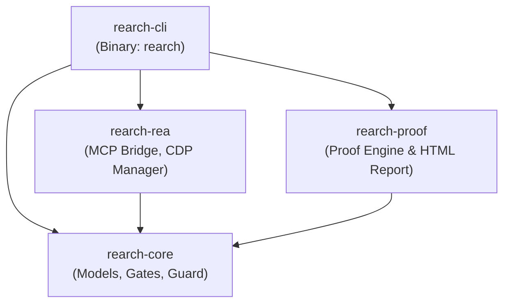

# Architecture & Design

`rearch` is architected as a modular Rust workspace (Edition 2021) designed for deterministic execution, strict boundary isolation, and multi-host interoperability.

---

## 🏗️ Workspace Crate Topology



### 1. `crates/rearch-core`
- **Purpose:** Core data models, validation invariants, human decision gate enforcement, legacy digest hashing, and security guardrail scanning.
- **Key Modules:**
  - `models.rs`: `EpistemicTier`, `VerificationStatus`, `BddSpec`, `Provenance`, `RuleCard`, `ProofVerdict`, `PreflightAnswers`, `Divergence`, `ProofVerdictRecord`, `HardenApproval`, and `EvidenceRow`.
  - `gates.rs`: Enforces Gates 1 through 6, legacy SHA-256 immutability verification, and Smallest Inventory First check.
  - `guard.rs`: Real-time prompt-injection scanner scanning untrusted legacy inputs, writing findings to `analysis/<slug>/security_findings.jsonl`.

### 2. `crates/rearch-rea`
- **Purpose:** Bridges to the `morluto/rea` MCP ecosystem via stdio JSON-RPC and manages Chrome DevTools Protocol (CDP) headless sessions.
- **Key Modules:**
  - `mcp_client.rs`: Stdio JSON-RPC client communicating with `npx -y rea-agents@latest mcp`. Enforces **REA Law 1** (session reuse via `analysis/<slug>/rea_sessions.json`), **REA Law 2** (Smallest Inventory First before deep decompilation/disassembly), prompt-injection scanning on tool responses, and binary format inspection using `goblin` (ELF, PE, Mach-O, archive).
  - `cdp.rs`: `CdpManager` launching isolated Chrome instances (`--remote-debugging-port=9222 --remote-debugging-address=127.0.0.1`) for live DOM and AST extraction.

### 3. `crates/rearch-proof`
- **Purpose:** Clean-build proof pack validation engine and self-contained Askama HTML report generator.
- **Key Modules:**
  - `verifier.rs`: Wipes dirty build artifacts, runs test runners, parses machine-readable results (`cargo test`, JSON vitest, JUnit XML via `quick-xml`), verifies legacy SHA-256 integrity, flags `0`-test runs as `NOT PROVEN`, and writes `analysis/<slug>/proof/verdict.json`.
  - `report.rs` & `templates/report.html`: Compiles project topology, BDD rule cards, gate statuses, and proof verdicts into `analysis/<slug>/REPORT.html`.

### 4. `crates/rearch-cli`
- **Purpose:** Command-line entry point (`rearch`) orchestrating the 9 stages, autonomous loop runner, and multi-host bootstrapper.
- **Key Modules:**
  - `main.rs`: CLI subcommand routing via `clap` (derive).
  - `commands.rs`: Implementations for `intent`, `preflight`, `assess`, `map`, `extract-rules`, `review`, `brief`, `sign`, `uplift`, `transform`, `reimagine`, `verify`, `proof-pack`, and `harden`. Refreshes `analysis/<slug>/REPORT.html` after every command.
  - `loop_runner.rs`: `/loop` and `/goal` state machine for `discover` (Window A) and `build` (Window B) with 2-turn stall detection.
  - `bootstrap.rs`: Pre-flight environment doctor and setup tool invoking `npx rea-agents` across all 4 host client targets (`antigravity`, `vscode`, `copilot_cli`, `claude_code`).

---

## 📁 Repository Directory Structure

```text
rearch/
├── Cargo.toml                                 # Cargo workspace configuration
├── INTENT.md                                  # Stage 0 default modernization intent
├── crates/
│   ├── rearch-cli/                            # CLI binary crate
│   ├── rearch-core/                           # Data models, gates, security guard
│   ├── rearch-rea/                            # REA MCP bridge & Chrome CDP
│   └── rearch-proof/                          # Proof engine & Askama HTML reports
├── legacy/<slug>/                             # Immutable mount of legacy artifact (SHA-256 locked)
├── analysis/<slug>/                           # Deterministic modernization artifacts
│   ├── REPORT.html                            # Dynamic, self-contained HTML dashboard
│   ├── BRIEF.md                               # Architecture modernization brief
│   ├── EVIDENCE_STATE.md                      # Provenance table across epistemic tiers
│   ├── LOOP_PROGRESS.md                       # Per-iteration append-only execution log
│   ├── preflight.json                         # Gate 1 preflight answers & SHA-256 digest
│   ├── map.json                               # Topology, dependency, and route graph
│   ├── rules/*.json                           # BDD Given/When/Then cards
│   ├── proof/verdict.json                     # Machine-verified proof verdict
│   ├── rea_sessions.json                      # REA session deduplication cache
│   └── security_findings.jsonl                # Prompt-injection audit trail
├── modernized/<slug>/                         # Modernized code, specs (OpenAPI/GraphQL), tests
├── .agents/                                   # Specialist agent markdown definitions & skills
├── .claude/                                   # Claude Code configuration & commands
├── .vscode/                                   # VS Code MCP and tasks configuration
├── .github/                                   # CI/CD workflows, copilot instructions, and prompts
└── .antigravity/                              # Antigravity agent & workflow bindings
```
