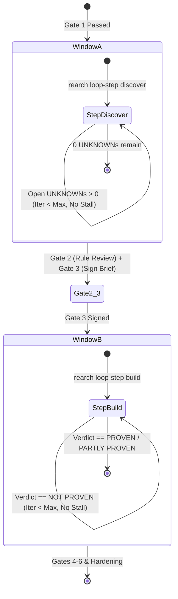

# Autonomous Loop Engine (`/loop` + `/goal`)

The core execution engine of `rearch` is a bounded, deterministic state machine driven by host loop prompts (Claude Code `/rearch-loop`, VS Code Chat `/rearch-loop`, Antigravity `/loop`).

---

## 🔄 Two-Window Execution Model

The pipeline divides autonomous execution into two distinct bounded windows separated by Human Gates 2 and 3:



### Window A: Discovery Window (`discover`)
- **Scope:** Stages 2–4 (`assess`, `map`, `extract-rules`).
- **Goal Criteria:** 
  1. `analysis/<slug>/EVIDENCE_STATE.md` contains 0 remaining items tagged as `UNKNOWN`.
  2. At least one evidence question/row is recorded.
- **Verification Command:**
  ```bash
  cargo run --bin rearch -- loop-step <slug> discover --max-iterations 25
  ```

### Window B: Reconstruction Window (`build`)
- **Scope:** Stages 6–7 (`uplift`/`transform`/`reimagine`, `verify`).
- **Goal Criteria:**
  1. Clean build succeeds.
  2. Test suite executes with `total > 0` and zero failures.
  3. `rearch proof-pack` returns `ProofVerdict::Proven` or `ProofVerdict::PartlyProven`.
- **Verification Command:**
  ```bash
  cargo run --bin rearch -- loop-step <slug> build --max-iterations 50
  ```

---

## 🛑 Bounded Loops & Stall Guard

To prevent indefinite agent looping and token exhaustion, the loop runner enforces two strict runtime limits:

### 1. Hard Iteration Cap
If the number of recorded non-empty turns in `analysis/<slug>/LOOP_PROGRESS.md` exceeds `max_iterations`, the harness halts immediately:
```text
Error: LOOP HALT: Max iteration cap (25) reached for sample-slug.
```

### 2. The 2-Turn Stall Guard
If two consecutive iterations in `LOOP_PROGRESS.md` record identical outcome signatures (e.g. failing on the same test or stuck on the same unknown query without state mutation), the engine terminates the loop:
```text
Error: LOOP HALT: Stall detected (2 consecutive identical outcomes). Pivot required.
```
This forces the host agent to pivot its hypothesis, seek user assistance, or re-inspect evidence with a different tool.

---

## 📝 The Append-Only Loop Log (`LOOP_PROGRESS.md`)

Every iteration appends a standardized Markdown entry:

```markdown
### Iteration 1 - 2026-10-18T22:20:00Z
- **Window:** discover
- **Action:** Extracted AST route definitions for /api/v1/auth
- **Outcome:** 2 UNKNOWN items remain (database session TTL, refresh token rotation)
- **Signature:** UNKNOWN_COUNT:2;RULES_COUNT:4
```
The signature line is evaluated by the stall detector to identify deadlock states.
