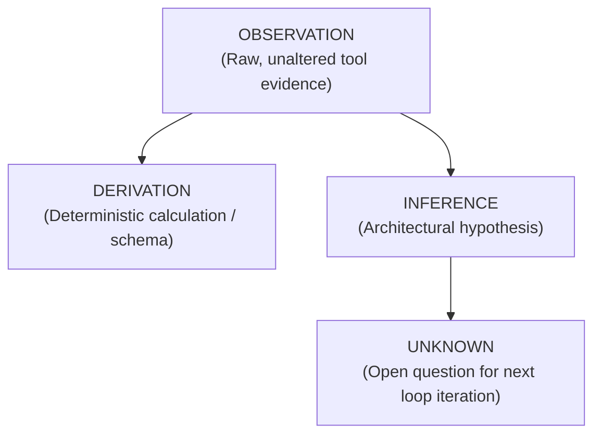

# Epistemic Tiers & BDD Rule Cards

A fundamental tenet of `rearch` is epistemic discipline: distinguishing between raw observations, derived facts, hypotheses, and unknowns.

---

## 🏷️ The Four Epistemic Tiers

Every finding discovered during reverse engineering is classified into one of four epistemic tiers defined in [`crates/rearch-core/src/models.rs`](../crates/rearch-core/src/models.rs):



1. **`OBSERVATION`**: Direct, unaltered output from an REA inspection tool with exact provenance (e.g. `artifact:line`, binary offset, HAR entry ID, DOM selector).
2. **`DERIVATION`**: A deterministic calculation or synthesized schema produced directly from observations (e.g. a JSON Schema computed from observed HTTP payloads).
3. **`INFERENCE`**: An architectural hypothesis or extrapolated business logic rule connecting multiple observations.
4. **`UNKNOWN`**: An unresolved question or missing evidence item queued for resolution during Loop Window A.

---

## 📊 The Provenance Table (`analysis/<slug>/EVIDENCE_STATE.md`)

Evidence is recorded in a standardized markdown table containing exact citations:

| ID | Tier | Category | Statement | Provenance |
| :--- | :--- | :--- | :--- | :--- |
| **Q-001** | `OBSERVATION` | `api` | POST /api/v1/tokens requires x-api-key header | `har:entry#42:headers` |
| **Q-002** | `DERIVATION` | `schema` | Token request body conforms to TokenRequest schema | `schemas/token.json#L1` |
| **Q-003** | `INFERENCE` | `security` | Tokens expire after 3600 seconds based on payload claim | `modernized/auth.rs#L89` |
| **Q-004** | `UNKNOWN` | `auth` | How does server handle refresh token replay? | *Unresolved* |

---

## 📜 BDD Given/When/Then Rule Cards (`analysis/<slug>/rules/*.json`)

Business rules are formalized into executable Gherkin specifications:

```json
{
  "rule_id": "RULE-AUTH-001",
  "name": "API Key Authentication Rejection",
  "tier": "OBSERVATION",
  "spec": {
    "given": "An incoming HTTP request to /api/v1/tokens",
    "when": "The x-api-key header is omitted",
    "then": "The service returns HTTP 401 with code 'AUTH_KEY_REQUIRED'"
  },
  "provenance": {
    "source_file": "legacy/server.js",
    "line_range": [142, 148],
    "rea_tool": "rea_har_inspector"
  },
  "verification": {
    "status": "Confirmed",
    "comment_discrepancy_flagged": false,
    "notes": "Verified against executable route handler bytecode."
  }
}
```

### Executable Truth Over Comments
If a legacy comment states:
```javascript
// Default session timeout is 15 minutes
```
...but the executable bytecode or AST reveals:
```javascript
const SESSION_TTL = 3600 * 1000; // 1 hour
```
The rule extractor flags `comment_discrepancy_flagged: true`, and `rearch` enforces the executable bytecode as ground truth.
