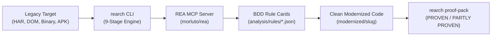

# Welcome to the `rearch` Wiki

**`rearch`** is an autonomous reverse-engineering and modernization harness written in Rust. It orchestrates **REA (`morluto/rea`)** inside a bounded **`/loop` + `/goal`** state machine governed by the 9-stage **`code-modernization`** workflow.

---

## 🚀 Quick Navigation

| Document | Description |
| :--- | :--- |
| [Architecture & Design](Architecture-and-Design.md) | 4-crate workspace topology, data flow, and Askama HTML reporting |
| [The 9-Stage Pipeline](The-9-Stage-Pipeline.md) | Ingestion through hardening with deterministic transition criteria |
| [Human Decision Gates](Human-Decision-Gates.md) | Gates 1-6 blocking unauthorized state transitions and legacy SHA-256 locking |
| [Autonomous Loop Engine](Autonomous-Loop-Engine.md) | Bounded dual-window loop (`discover` & `build`) with 2-turn stall guard |
| [REA Engine & Reverse Engineering](REA-Engine-and-Reverse-Engineering.md) | 4 REA Laws, MCP bridge, CDP manager, and format-aware target inspection |
| [Epistemic Tiers & BDD Rule Cards](Epistemic-Tiers-and-BDD-Rule-Cards.md) | 4 epistemic tiers, provenance tracking, and Given/When/Then specification cards |
| [Deterministic Proof Pack](Deterministic-Proof-Pack.md) | Clean-run validation, machine test parsers, and proof verdicts |
| [Specialist Agents](Specialist-Agents.md) | Roles and constraints for `architecture-critic`, `rule-extractor`, `rule-verifier`, and `code-simplifier` |
| [Multi-Host Setup](Multi-Host-Setup.md) | Bootstrap and workflow integration for Antigravity, VS Code Copilot, and Claude Code |
| [CLI Reference](CLI-Reference.md) | Complete CLI syntax, flags, subcommands, and environment variables |

---

## 💡 System Mission

Legacy reverse engineering and modernization are often derailed by:
1. **Hallucinated behavior:** Relying on outdated comments, docstrings, or LLM assumptions instead of byte-level execution truth.
2. **Endless loops:** Agents drifting indefinitely without convergence criteria, iteration caps, or stall detection.
3. **Unchecked tampering:** Modernization tasks inadvertently mutating the legacy artifact.
4. **Unreviewed transitions:** Handing off unreviewed architecture shifts or silent behavioral divergences.

`rearch` solves this by pairing:
- **Autonomous agents** powered by format-aware MCP tools (`rea-agents`).
- **A deterministic Rust harness** enforcing SHA-256 legacy immutability, 6 unbypassable human decision gates, machine-verified test counts, prompt-injection defense, and bounded loop terminations.

---

## ⚡ High-Level Workflow

1. **Bootstrap & Intent:** Verify host tooling (`rearch bootstrap --mode doctor`) and define the modernization scope (`rearch intent <slug>`).
2. **Preflight & Gate 1:** Compute SHA-256 legacy digest, mount read-only target, and record the human's answers to the 5 Preflight Questions.
3. **Loop Window A (Discover):** Run `rearch loop-step <slug> discover` to inspect topology, extract BDD rule cards, and resolve all `UNKNOWN` epistemic tags.
4. **Gates 2 & 3:** Resolve disputed rule cards (`rearch review <slug>`) and approve the architecture steering brief (`rearch sign <slug>`).
5. **Loop Window B (Build):** Run `rearch loop-step <slug> build` to synthesize clean-room code and pinning tests until `rearch proof-pack` passes.
6. **Gates 4, 5 & 6:** Accept divergences (`Gate 4`), sign the proof report (`Gate 5`), and review/apply the security hardening patch (`Gate 6`).
