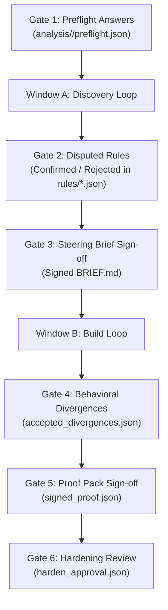

# Human Decision Gates & Safety Invariants

To prevent hallucinated modernization decisions and uncontrolled autonomous code synthesis, `rearch` enforces **6 Human Decision Gates** that cannot be bypassed by an AI model, along with a cryptographically verified **Legacy Immutability Invariant**.

---

## 🔒 The Legacy Immutability Invariant

The source artifact in `legacy/<slug>` represents historical ground truth. `rearch` computes a cumulative SHA-256 digest of all files in `legacy/<slug>` during Stage 1 (`preflight`) and writes it to `analysis/<slug>/preflight.json`.

Before every single loop iteration, stage transition, and proof pack verification, [`verify_legacy_unmodified(slug)`](../crates/rearch-core/src/gates.rs) re-hashes `legacy/<slug>`. If even a single byte has changed, execution immediately halts with:

```text
Error: LEGACY MUTATION DETECTED for <slug>! Expected digest <orig_hash>, found <new_hash>. Legacy files are immutable.
```

---

## 🚦 The 6 Human Decision Gates



### Gate 1: Preflight Questionnaire
- **Validation Function:** `verify_gate_1_locked(slug)`
- **Artifact:** `analysis/<slug>/preflight.json`
- **Requirement:** Answers to the 5 mandatory scoping questions:
  1. `scope`: Whole system or slice?
  2. `runs_locally`: Does legacy run locally?
  3. `custom_build_tooling`: Custom build tooling required?
  4. `prior_attempts`: Any prior modernization attempts?
  5. `off_limits`: Any off-limits components or dependencies?

### Gate 2: Disputed Business Rules
- **Validation Function:** `verify_gate_2_reviewed(slug)`
- **Artifacts:** `analysis/<slug>/rules/*.json`
- **Requirement:** Every rule card where `rule-extractor` and `rule-verifier` diverged must be explicitly confirmed or resolved by a human operator (`verification.status` must not be `Disputed`).

### Gate 3: Steering Brief Sign-Off
- **Validation Function:** `verify_gate_3_signed(slug)`
- **Artifact:** `analysis/<slug>/BRIEF.md`
- **Requirement:** The human architect reviews the findings of `architecture-critic` and adds a signature block:
  ```markdown
  ## Human Sign-Off
  Signed by: Alice Architect
  Date: 2026-10-18
  Status: APPROVED
  ```
  No file in `modernized/<slug>` can be synthesized without Gate 3 approval.

### Gate 4: Behavioral Divergences
- **Validation Function:** `verify_gate_4_divergences(slug, detected_divergences)`
- **Artifact:** `analysis/<slug>/accepted_divergences.json`
- **Requirement:** Any behavioral delta between legacy execution and modernized execution must have a recorded human acceptance entry with rationale and author.

### Gate 5: Proof Pack Sign-Off
- **Validation Function:** `verify_gate_5_proof_signed(slug)`
- **Artifact:** `analysis/<slug>/proof/signed_proof.json`
- **Requirement:** Human approval of the final test suite run, verifying that the `PROVEN` or `PARTLY PROVEN` verdict is legitimate and all edge cases were evaluated.

### Gate 6: Hardening Patch Review
- **Validation Function:** `verify_gate_6_harden_signed(slug)`
- **Artifact:** `analysis/<slug>/harden_approval.json`
- **Requirement:** Human operator inspects `analysis/<slug>/harden.patch` and provides explicit approval before applying security patches to production-candidate code.
