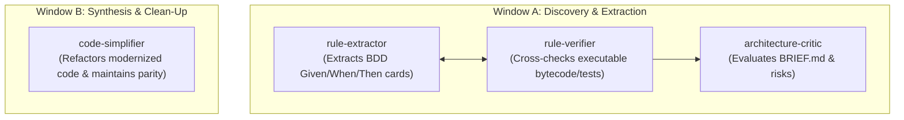

# Specialist Autonomous Agents

`rearch` employs four specialized autonomous agent roles coordinated by the orchestrator:

---

## 👥 The Four Specialist Roles

### 1. `rule-extractor` (`.agents/agents/rule-extractor.md`)
- **Type:** Author / Synthesizer
- **Scope:** Reads legacy source, HAR captures, and binary symbol tables.
- **Responsibility:** Writes Given/When/Then specification cards in Gherkin format. Cites exact byte offsets, line numbers, or network request IDs in `provenance`.
- **Constraint:** Must never guess behavior; missing details must be tagged as `UNKNOWN`.

### 2. `rule-verifier` (`.agents/agents/rule-verifier.md`)
- **Type:** Independent Auditor (Dual-Agent Review)
- **Scope:** Independent evaluator verifying rule cards against executable ground truth.
- **Responsibility:** Executes test runners, inspects raw disassembly, and challenges any rule card where source comments disagree with runtime behavior.
- **Constraint:** If the verifier disagrees with the extractor, the rule is flagged as `Disputed` and must be resolved by a human operator in **Gate 2**.

### 3. `architecture-critic` (`.agents/agents/architecture-critic.md`)
- **Type:** Read-Only Reviewer
- **Scope:** Inspects `analysis/<slug>/BRIEF.md`, `map.json`, and proposed architecture changes.
- **Responsibility:** Evaluates maintainability, security boundaries, performance bottlenecks, and framework transitions.
- **Constraint:** Cannot write or modify code; produces markdown review sections directly incorporated into `BRIEF.md` before **Gate 3** human sign-off.

### 4. `code-simplifier` (`.agents/agents/code-simplifier.md`)
- **Type:** Refactoring Specialist
- **Scope:** Active during Loop Window B (`build`).
- **Responsibility:** Cleans up synthesized code in `modernized/<slug>`, eliminates dead code, enforces idiomatic Rust/TypeScript patterns, and optimizes data structures.
- **Constraint:** Must rerun `rearch proof-pack` after any change; any test regression causes an immediate revert.
