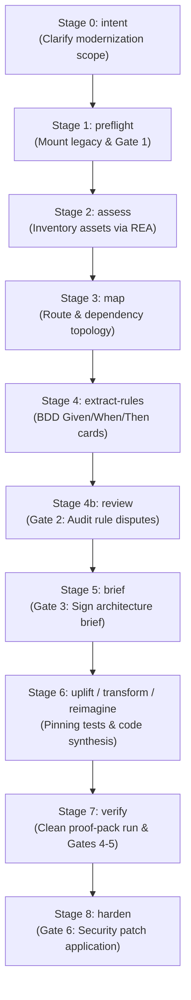

# The 9-Stage Modernization Pipeline

`rearch` structures reverse engineering and system modernization into 9 discrete, auditable stages based on the `code-modernization` framework:

---

## 📋 Stage Details

### Stage 0: `intent`
- **Command:** `rearch intent <slug>`
- **Purpose:** Establishes the modernization scope, target platforms, and high-level goals.
- **Output:** Creates `analysis/<slug>/INTENT.md` (and updates root `INTENT.md`).

### Stage 1: `preflight` & Gate 1
- **Command:** `rearch preflight <slug>`
- **Purpose:** Verifies host environment, validates read-only permissions on `legacy/<slug>`, computes and records the SHA-256 legacy digest, and enforces **Gate 1** (5 Preflight Questions).
- **Output:** Generates `analysis/<slug>/preflight.json`.

### Stage 2: `assess`
- **Command:** `rearch assess <slug>`
- **Purpose:** Executes REA Law 2 (Smallest Inventory First) to inspect high-level manifests, package structures, archive directories, or binary symbols without triggering expensive decompilations.
- **Output:** Updates `analysis/<slug>/EVIDENCE_STATE.md` with initial `OBSERVATION` inventory.

### Stage 3: `map`
- **Command:** `rearch map <slug>`
- **Purpose:** Discovers call graphs, module boundaries, network routes, external dependencies, and state boundaries.
- **Output:** Generates `analysis/<slug>/map.json`.

### Stage 4: `extract-rules`
- **Command:** `rearch extract-rules <slug>`
- **Purpose:** Iteratively dispatches the `rule-extractor` specialist agent to synthesize Gherkin `Given/When/Then` cards with exact byte/line provenance, while `rule-verifier` validates executable truth.
- **Output:** Writes individual rule cards to `analysis/<slug>/rules/*.json`.

### Stage 4b: `review` & Gate 2
- **Command:** `rearch review <slug>`
- **Purpose:** Surfaces rule disputes between the extractor and verifier for human resolution (**Gate 2**).
- **Pass Condition:** All rule cards marked as `Confirmed` or `Rejected` (no unresolved disputes).

### Stage 5: `brief` & Gate 3
- **Command:** `rearch brief <slug>` and `rearch sign <slug>`
- **Purpose:** Assembles `analysis/<slug>/BRIEF.md`, including architecture critic findings, migration strategy, and risk assessment.
- **Gate 3 Human Sign-Off:** Modernization code cannot be written to `modernized/<slug>` until a human signs the brief.

### Stages 6-7: Reconstruction & Verification
- **Commands:**
  - `rearch uplift <slug>` (conservative refactoring / uplift)
  - `rearch transform <slug>` (framework migration)
  - `rearch reimagine <slug>` (clean-room greenfield reconstruction)
  - `rearch verify <slug>` / `rearch proof-pack <slug>`
- **Purpose:** Synthesizes pinning tests, migrates modules, and executes clean-run proof verification until verdict is `PROVEN` or `PARTLY PROVEN`.
- **Gates 4 & 5:** Gate 4 accepts documented behavioral differences (`accepted_divergences.json`); Gate 5 signs the final proof verdict (`signed_proof.json`).

### Stage 8: `harden` & Gate 6
- **Command:** `rearch harden <slug>`
- **Purpose:** Scans modernized code for supply-chain vulnerabilities, unescaped queries, or memory issues and generates `analysis/<slug>/harden.patch`.
- **Gate 6:** Applies the reviewed security patch after explicit human approval (`harden_approval.json`).
